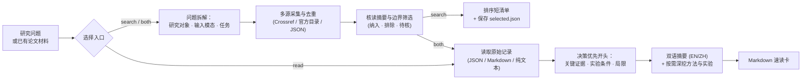

<div align="center">

# PaperResearch

[English](README.md) · **简体中文**

[](#方式一作为-ai-助手技能安装使用)
[](#方式二独立-python-cli--任意大模型-api)
[](#方式二独立-python-cli--任意大模型-api)
[](.github/workflows/ci.yml)

**把模糊的研究问题变成“有排序、有依据”的精选短清单，再把入选论文变成“先讲关键证据与边界”的双语速读卡。**

</div>

PaperResearch 是一套通用的 **Agent Skill（智能体技能）** 与 **跨模型 CLI 工具链**，专门解决学术文献**搜调去噪**与**快速精筛**问题。你可以单独运行 `search`（检索筛选）、单独运行 `read`（生成速读卡），或用 `both` 一步串联执行；既能直接装进 Codex / Claude Code / Gemini / Cursor 等编程与科研助手，也能在终端接入任意大模型 API 独立跑。

---

## 为什么需要 PaperResearch？

做跨方向调研时，普通搜索引擎和通用大模型总结常常让人踩坑：召回一堆假阳性、摘要说得很好听但真正影响“能不能用”的实验条件全被略过。

| 常见痛点 | PaperResearch 的解决思路 |
| --- | --- |
| **关键词与出处陷阱** <br/>搜交叉主题经常撞上子串误匹配（如 `NeRF` 匹配 `RF`）、无关缩写（如大模型里的 `RADAR`），以及混在会议集里的 Demo / Workshop。 | **“对象 + 模态 + 任务”三元拆解** <br/>检索前先固定边界与防误召回规则；按 DOI 或正式书目去重；摘要不足以拍板的条目单列`待核`，绝不浑水摸鱼。 |
| **普通总结隐去致命边界** <br/>一句“准确率高达 95%”看似亮眼，翻开 PDF 才发现是闭集随机切分、纯数值仿真，或根本不是你要的任务粒度。 | **决策优先的速读卡结构** <br/>每张卡开头先回答“做了什么、最关键的证据是什么、在什么条件下成立”（数据集、划分方式、指标、阅读依据），再展开摘要与细节。 |
| **多轮对话丢出处、编细节** <br/>在对话框里先搜再读，往往中途丢了 DOI 或原摘要，模型还容易把摘要脑补成并不存在的网络细节。 | **基于 `paper_id` / DOI 的无损交接** <br/>`search` 选中后通过 `--save-selected` 完整保留原始记录与摘要，无缝交给 `read`；严守“依据摘要 / 全文”界线，缺项直接标`待核`。 |
| **动辄上全套审计太拖节奏** <br/>日常只是想先挑 5 篇高价值论文开读，如果每次都强制生成几十页覆盖率审计表，反而背离阅读直觉。 | **按需触发的系统级严谨性** <br/>日常探路先交付高信号短清单，把精力花在最值得读的论文上；只有当你明确要“穷举、统计数量、论证研究空白”时，才展开全集核验、排除日志与覆盖缺口报告。 |

---

## 核心功能与工作流

两步可以按需独立调用，也可以通过稳定 ID 一键串联：

| 入口 | 解决什么场景 | 输入 | 交付结果 |
| --- | --- | --- | --- |
| **`search`** | *“这个方向最值得先读哪几篇？”* | 研究问题 + Crossref 检索或候选 JSON | 按阅读价值排序的短清单（含入选理由、DOI/出处、`待核`标记），可保存 `selected.json` |
| **`read`** | *“我手里已经有论文了，快速判断读不读/怎么用”* | `selected.json`、摘要、Markdown 笔记或提取后的 PDF 文本 | 决策优先的 Markdown 卡片（关键证据前置 + 中英双语摘要/释义 + 来源依据） |
| **`both`** | *“帮我筛完直接出可读卡片”* | 研究问题 + Crossref 检索或候选 JSON | 先出短清单，再直接基于原始材料生成对应速读卡，杜绝中间失真 |



---

## 快速开始

### 方式一：作为 AI 助手技能安装使用

将本仓库的技能目录（包含 `SKILL.md` 与 `references/`）复制到你的 AI 助手技能路径即可：

```bash
# 例如安装到 Codex、Claude Code 或当前项目的技能目录：
cp -r path/to/paper-research ~/.codex/skills/paper-research
# 或用于 Claude Code：
cp -r path/to/paper-research ~/.claude/skills/paper-research
```

安装后直接在对话中用自然语言调用（中英文均可）：

- **只找论文（`search`）：**
  > 用 `paper-research` 帮我找 5 篇关于可穿戴感知跨天域泛化的最新顶会/顶刊论文，按实验证据的直接程度排序，每篇给一句入选理由。
- **只读已有材料（`read`）：**
  > 用 `paper-research` 的 `read` 模式整理我附上的这几篇摘要/PDF，每张卡开头先点明任务定义、实验划分和关键数据，并附中英文双语摘要。
- **两步连用（`both`）：**
  > 帮我检索 3 篇事件相机与雷达融合的小目标跟踪论文，排除纯仿真验证的工作，先给筛选清单再生成决策优先的双语速读卡。

### 方式二：独立 Python CLI & 任意大模型 API

支持两类接入路径：**纯 Python 标准库直连任何 OpenAI Chat Completions 兼容端点**（零第三方依赖），或通过 **LiteLLM** 调用 OpenAI / Anthropic / Gemini 等原生厂商接口。

#### A. OpenAI 兼容端点（零依赖，仅需标准库）

兼容官方 OpenAI API、各类中转站、vLLM、Ollama、DeepSeek、Qwen、OneAPI 等：

```bash
export PAPER_MODEL="openai/<你的模型或部署名>"
export PAPER_BASE_URL="https://api.openai.com/v1"   # 按服务端要求带 /v1 等前缀
export OPENAI_API_KEY="<你的密钥>"

# 先用内置示例数据离线跑通“筛选 → 保存 → 速读”交接：
python scripts/run.py search "找出候选中评估跨采集日泛化的工作" \
  --input examples/candidates.json \
  --save-selected papers.json

python scripts/run.py read "生成双语阅读卡，重点点明任务与实验划分" \
  --input papers.json
```

#### B. 通过 LiteLLM 接入多家模型商

```bash
python -m pip install litellm
export PAPER_MODEL="anthropic/claude-sonnet-4-20250514"   # 或 gemini/..., openai/...
export ANTHROPIC_API_KEY="<你的密钥>"

# 省略 --input 并指定 --query，即可从 Crossref 实时拉取候选并一步筛选+速读：
python scripts/run.py both "筛选开放集射频设备识别相关论文并生成速读卡" \
  --query "open-set radio frequency fingerprint identification" \
  --limit 20 \
  --save-selected selected.json > cards.md
```

> **提示：** 内置实时检索默认从 Crossref 拉取 `--limit` 条（默认 `20`，上限 `100`）候选用作快速探索。如果需要对指定会议/期刊做穷举式盘点，只需先将官方目录/索引结果整理成 JSON 数组传给 `--input`。完整参数、JSON 格式和跨语言 SDK 接入说明见 [API 与命令行文档](references/api.md)。

### 方式三：直接复用 Markdown 提示词（无环境依赖）

任何语言或工作流只需读取 [`references/search.md`](references/search.md) 与 [`references/read.md`](references/read.md) 的 UTF-8 文本，拼上你的研究问题与论文材料即可发给模型——不依赖联网工具或 Function Calling。

---

## 实战样例展示：UAV × RF 交叉文献全流程搜调

为了直观展示这套通用流程如何应对**高噪声术语、严苛任务边界以及大规模跨库盘点**，我们完整整理了此前一次真实科研调研的运行流：**CCF A 类（2024–2026）“无人机（UAV）识别 × 射频（RF）感知”交叉文献搜调与速读**。

1. **多源召回与官方目录对齐：** 结合 Semantic Scholar 索引扫描（`113,922` 条记录）与 11 个可取得官方主会目录（`50,427` 条标题）、Crossref、OpenAlex 及 4 篇种子论文的引文雪球补检，覆盖 **95 个 CCF A 类 venue**（58 会议 + 37 期刊）；遇到 DBLP 反爬页、INFOCOM 官网 HTTP 418 等异常时如实记入覆盖缺口，不报假零。
2. **噪声拦截与漏斗清洗（`5,884` 候选 → `1,002` 纳入 / `4,375` 排除 / `507` 待核）：** 成功挡掉 `OSNeRF`（`NeRF` 误匹配 `RF`）、`RADAR`（LLM 通信拓扑缩写）、`AGR`（声学 FMCW）、`CAPSID`（Remote ID 隐私协议），以及混在 AAAI/MobiCom/INFOCOM 合集中的 `IAAI` 与 Demo/Workshop 短文。
3. **19 篇 `UAV × RF` 交叉论文的粒度甄别：** 拒绝把不同任务混为一谈，明确拆出 **硬件 CFO 指纹认证（1 篇，且标出仅数值仿真）**、**无人机机型/开集 RF 识别（3 篇，且标出非个体硬件/重训用未知样本）**、**信道/运动/CSI 检测（4 篇）** 与 **视射融合定位/雷达跟踪/ISAC 平台（11 篇）**。
4. **下游闭环产出：** 为全部 **1,002 篇**纳入论文生成摘要级双语速读卡，并归纳为 **8 大核心问题类别**，直接定位出“真实跨接收机/跨天硬件级 UAV RFFI 严重稀缺”的研究空白。

<details>
<summary><strong>点击展开：UAV × RF 真实样例中的筛选输出与速读卡预览</strong></summary>

**测试输入：** [`examples/uav-rf/candidates.json`](examples/uav-rf/candidates.json)（6 条真实论文记录，故意混入了硬件 CFO 认证、机型 RFFI、开集识别、视射融合定位、Remote ID 协议与 `NeRF` 误召回）。

**1. `search` 阶段输出（排序短清单 + 自动拦截陷阱）：**

```markdown
范围与结论：已核查 6 篇候选。1 篇直接建模无人机硬件 CFO 指纹（仅数值仿真，需核实真实实验）；2 篇为无人机机型级 RF/开集识别；1 篇为降落定位任务仅作相邻参考；2 篇因属于协议隐私或 NeRF 误召回已排除。

- Enhanced Two-Way Privacy-Preserving PHY-Layer Authentication for UAV-Assisted MIMO Systems（IEEE TDSC，2025） · 10.1109/tdsc.2025.3594095 · 直接以 MOOSE 提取的 CFO 作为 UAV 硬件身份指纹并结合 ECC 认证，但摘要仅说明数值仿真，跨接收机与跨天真实表现[待核]。
- Lightweight Memory Network for Drone Type RF Fingerprint Identification in Dynamic Environments（IEEE TIFS，2026） · 10.1109/tifs.2026.3734750 · 研究动态遮挡环境下的无人机 RF 时频谱识别（95.16% 平均准确率），但数据集为 9 类无人机机型，是否包含同型号个体区分[待核]。
- Multi-Domain Supervised Contrastive Learning for UAV Radio-Frequency Open-Set Recognition（IEEE JSAC，2026） · 10.1109/jsac.2026.3669136 · 提出了多域融合与改进 OpenMax 的无人机 RF 开集识别（25 种机型闭集 95.12% / 开集 96.08%），但属于机型层级且分类层重训用到了未知样本。
- [相邻工作 / 仅定位] mmE-Loc: Facilitating Accurate Drone Landing With Ultra-High-Frequency Localization（IEEE TMC，2026） · 10.1109/tmc.2026.3666235 · 事件相机与毫米波雷达融合实现 0.083 m / 5.12 ms 降落定位，任务为空间定位而非设备身份识别。

已排除：
- CAPSID（ACM CCS，2024） · 10.1145/3658644.3690324 · Remote ID 广播隐私会话协议，无物理层 RF 感知或硬件指纹。
- OSNeRF（ACM MM，2024） · 10.1145/3664647.3681686 · 仅因 NeRF 匹配到 "RF" 子串，实为纯视觉三维重建。
```

**2. `read` 阶段卡片输出（节选）：**

> **Lightweight Memory Network for Drone Type RF Fingerprint Identification in Dynamic Environments** · IEEE TIFS, 2026 · `10.1109/tifs.2026.3734750`
>
> **阅读价值与边界：** 该文用多尺度 spectrogram、通道/空间注意力、全局-局部双路径和可训练 memory/gate 做动态遮挡下的无人机 RF 识别，在 9 类数据集上报告 **95.16% 平均准确率**。抗动态遮挡的特征设计值得借鉴，**但引用为个体级 RFFI 前需核查全文协议**（摘要仅确立 9 种无人机类别划分）。
>
> **English Abstract (Paraphrase):** Studies drone RF fingerprint recognition under time-varying propagation and obstruction using multiscale spectrograms, dual global/local attention paths, and gated memory fusion on a 9-category dataset (95.16% mean accuracy).
>
> **中文摘要（对应释义）：** 研究动态遮挡传播下的无人机 RF 指纹识别，结合多尺度频谱、注意力与可训练记忆门控融合，在 9 类无人机数据集上取得 95.16% 平均准确率；是否区分同型号个体需核查全文实验协议。

</details>

- [**UAV × RF 全流程实战样例详解（简体中文）**](examples/uav-rf/README.zh-CN.md) · [**End-to-End Walkthrough (English)**](examples/uav-rf/README.md)
- [**19 篇 UAV × RF 交叉论文原始卡片节选**](examples/uav-rf/ccf-a-uav-rf.md) · [**可直接复跑的 6 篇候选 JSON**](examples/uav-rf/candidates.json)
- [**CVPR 2024 先导调研卡片节选：** 航空视觉（7 篇）](examples/uav-rf/cvpr-aerial-vision.md) · [RF 感知（12 篇）](examples/uav-rf/cvpr-rf-sensing.md)

---

## 仓库结构

```text
paper-research/
├── SKILL.md                        # Agent Skill 入口（按用户意图路由到 search / read / both）
├── references/
│   ├── search.md                   # 检索、去重与按需覆盖审计指令
│   ├── read.md                     # 决策优先双语速读卡指令
│   └── api.md                      # CLI 参数、JSON 输入规范与多模型商接入指南
├── scripts/
│   └── run.py                      # 通用命令行脚本（Crossref + OpenAI 标准库 / LiteLLM）
├── examples/
│   ├── candidates.json             # 最小化 2 篇虚构示例（用于快速冒烟测试）
│   └── uav-rf/                     # 真实 UAV × RF 全流程样例、可运行 JSON 与原始卡片节选
├── tests/
│   └── test_cli.py                 # 使用本地模拟端点验证 search / read / both 与数据交接的单元测试
└── .github/workflows/ci.yml        # GitHub Actions 自动化测试工作流（Python 3.12）
```

> **提示词语言说明：** `SKILL.md` 与 `references/` 中的核心提示词采用简体中文编写，支持同时处理中英文文献并默认交付中英双语速读卡。

---

## 测试与验证

在本地运行单元测试（使用内置本地模拟 HTTP 端点，无需联网或真实 API Key）：

```bash
python -m unittest discover -s tests -v
```

每次 `push` 和 `pull_request` 都会触发 GitHub Actions 自动校验三个 CLI 入口与记录交接逻辑（[`.github/workflows/ci.yml`](.github/workflows/ci.yml)）。
